# Experimentos: comparación de planificadores y heurísticas de asignación

## 1. Objetivo

Evaluar el comportamiento del sistema de planificación distribuida sobre dos nodos mediante dos experimentos:

1. **RMS frente a EDF:** comparar ambos planificadores con una carga de tareas periódicas planteada para cumplir los plazos con *Earliest Deadline First* (EDF) e incumplirlos con *Rate Monotonic Scheduling* (RMS).
2. **First-Fit frente a Worst-Fit:** comprobar que, ante una misma carga, ambas heurísticas producen asignaciones distintas y comparar la utilización resultante de cada nodo.

Las evidencias corresponden a las gráficas temporales y tablas de utilización generadas por el sistema.

### Interpretación de las gráficas y métricas

En las trazas, cada fila de tarea muestra sus ejecuciones mediante bloques de color. Los marcadores **L**, **C** y **D** identifican, respectivamente, la liberación de una instancia, su finalización y su fecha límite (*deadline*). La fila «Nodo / idle» permite observar los intervalos registrados como inactivos y otros eventos del nodo.

Para las tablas se utilizan las siguientes métricas:

- **Ticks activos:** duración de la ventana observada según el contador del informe.
- **Ocupados / idle registrado:** ticks clasificados como ejecución de trabajo o inactividad.
- **Utilización teórica:** carga estimada a partir de los parámetros temporales de las tareas (habitualmente, \(U = \sum_i C_i/T_i\)).
- **Utilización medida:** proporción de ocupación registrada durante la ventana de observación.
- **Cambios:** cantidad reportada en el campo «Cambios» del sistema.

> **Precaución:** el campo «Fallas» no está identificado en las capturas como un contador de incumplimientos de *deadline*. Por lo tanto, que aparezca en cero no demuestra por sí mismo que todas las instancias hayan cumplido sus fechas límite. Para demostrarlo de forma concluyente se requiere comparar, por instancia, los tiempos de finalización y los *deadlines*.

---

## 2. Experimento 1: RMS frente a EDF

### 2.1. Propósito y configuración observada

Se comparan las ejecuciones etiquetadas como `rms_*_falla` y `edf_*_nofalla`. La intención del caso es exhibir una carga que pueda atenderse con prioridades dinámicas EDF y que presente problemas bajo las prioridades fijas de RMS.

Según las trazas, las asignaciones visibles no son idénticas en ambas ejecuciones:

| Planificador | Nodo 1 (ESP) | Nodo 2 (Pico) |
| --- | --- | --- |
| **RMS** | Tareas 1, 6, 7 y 8 | Tareas 2, 3, 4 y 5 |
| **EDF** | Tarea 6 | Tareas 1, 2, 3, 4, 5, 7 y 8 |

Esta diferencia es relevante: las capturas permiten contrastar el **comportamiento del sistema completo** en cada configuración, pero no aíslan exclusivamente el efecto del algoritmo RMS o EDF, porque también cambia la distribución de tareas entre nodos.

### 2.2. Resultados con RMS

**Nodo 1 (ESP).** La traza muestra la ejecución de las tareas 1, 6, 7 y 8. Se aprecian instancias en las que el marcador de fecha límite `D` aparece antes de la ejecución o finalización dibujada para la tarea; por ejemplo, al comienzo de la fila de la tarea 6. Esto es un indicio visual de posibles incumplimientos temporales, que debe contrastarse con los registros de cada instancia.

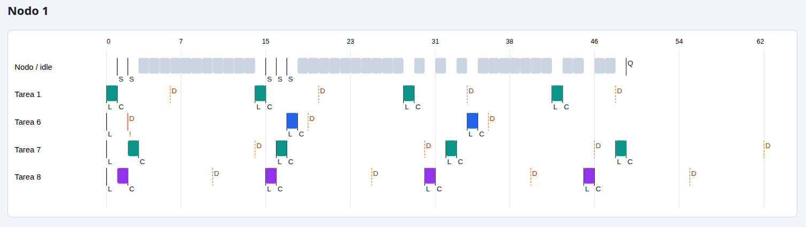

**Nodo 2 (Pico).** Las tareas 2, 3, 4 y 5 comparten el segundo nodo. La traza permite examinar el orden de ejecución y su relación con las fechas límite.

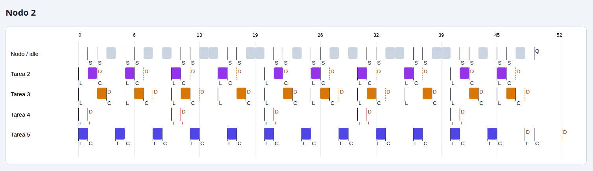

**Utilización registrada con RMS:**

| Nodo | Ticks activos | Ocupados | Idle registrado | Utilización teórica | Utilización medida | Cambios | Fallas | Tramas inválidas |
| --- | ---: | ---: | ---: | ---: | ---: | ---: | ---: | ---: |
| 1 | 49 | 14 | 35 | 25.94 % | 28.57 % | 5 | 0 | 0 |
| 2 | 49 | 32 | 16 | 75.00 % | 66.67 % | 20 | 0 | 0 |

En esta ejecución, la utilización teórica se distribuye en **25.94 % para el nodo 1** y **75.00 % para el nodo 2**. La utilización medida es distinta debido a la ventana de observación y al patrón efectivo de trabajo. La suma de los ticks clasificados como ocupados e idle del nodo 2 es 48, aunque el informe muestra 49 ticks activos; se conservan los valores originales, sin corregirlos artificialmente.

### 2.3. Resultados con EDF

**Nodo 1 (ESP).** En la captura aparece únicamente la tarea 6, con ejecuciones breves y amplios intervalos de inactividad.

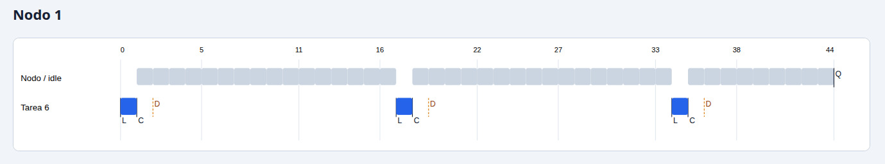

**Nodo 2 (Pico).** La mayor parte de la carga se concentra en el segundo nodo, que ejecuta las tareas 1, 2, 3, 4, 5, 7 y 8. Las ejecuciones se intercalan en el tiempo y el nodo tiene poca inactividad registrada.

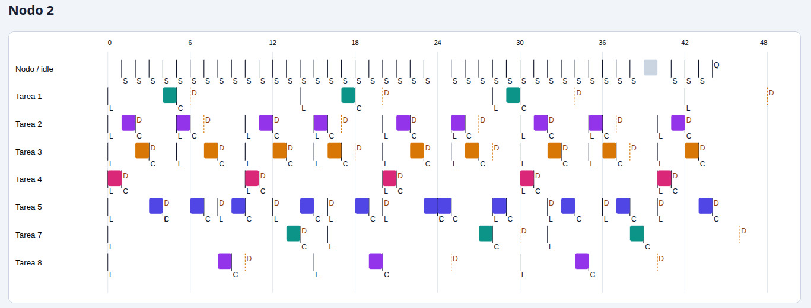

**Utilización registrada con EDF:**

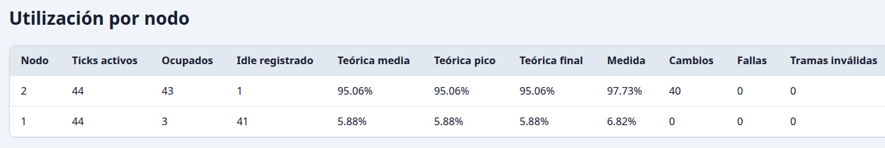

| Nodo | Ticks activos | Ocupados | Idle registrado | Utilización teórica | Utilización medida | Cambios | Fallas | Tramas inválidas |
| --- | ---: | ---: | ---: | ---: | ---: | ---: | ---: | ---: |
| 1 | 44 | 3 | 41 | 5.88 % | 6.82 % | 0 | 0 | 0 |
| 2 | 44 | 43 | 1 | 95.06 % | 97.73 % | 40 | 0 | 0 |

La carga teórica de EDF está muy concentrada en el nodo 2 (**95.06 %**), cuya ocupación medida alcanza **97.73 %**. El nodo 1 mantiene una utilización baja (**6.82 % medida**).

### 2.4. Comparación y evaluación del experimento

| Aspecto | RMS | EDF |
| --- | --- | --- |
| Distribución teórica de utilización (nodo 1 / nodo 2) | 25.94 % / 75.00 % | 5.88 % / 95.06 % |
| Utilización medida (nodo 1 / nodo 2) | 28.57 % / 66.67 % | 6.82 % / 97.73 % |
| Cambios registrados (nodo 1 + nodo 2) | 25 | 40 |
| Fallas registradas en la tabla | 0 | 0 |
| Resultado temporal sugerido por los nombres y las trazas | Caso denominado «falla», con posibles plazos incumplidos | Caso denominado «nofalla», con ejecución concentrada en el nodo 2 |

**Interpretación.** Las evidencias muestran dos comportamientos distintos, y el cronograma de RMS contiene indicios visuales de tardanza. Sin embargo, **estas capturas por sí solas no verifican de manera concluyente la afirmación «esta carga solo cumple EDF»**: además de que la asignación cambia, no se incluye un conteo inequívoco de instancias finalizadas después de `D`.

Para cerrar la demostración experimental, debe repetirse la prueba con **exactamente las mismas tareas, parámetros \(C_i\), \(T_i\), \(D_i\), condiciones iniciales y asignación por nodo**, cambiando únicamente RMS por EDF. Luego, para cada instancia liberada, debe verificarse si `C` ocurre antes o en `D`, y reportar el número de vencimientos de plazo para cada planificador.

> **Conclusión del experimento 1:** la ejecución denominada EDF «sin falla» muestra un nodo 2 próximo al 100 % de ocupación, mientras que la ejecución RMS presenta una distribución diferente y posibles problemas temporales. El objetivo de demostrar una carga factible **solo con EDF** queda respaldado de forma **preliminar, no definitiva**, hasta disponer de una comparación controlada y un conteo explícito de *deadlines* incumplidos.

---

## 3. Experimento 2: First-Fit frente a Worst-Fit

### 3.1. Propósito

Verificar que las heurísticas de asignación producen distribuciones distintas ante un mismo conjunto de tareas. En **First-Fit**, las tareas se colocan en el primer nodo que satisface las condiciones de admisión. En **Worst-Fit**, se favorece el nodo con mayor capacidad disponible dentro del criterio implementado, buscando repartir la carga.

Las capturas de EDF y RMS permiten comprobar la asignación resultante, independientemente del planificador utilizado para ordenar las ejecuciones dentro de cada nodo.

### 3.2. Asignación de tareas observada

| Heurística | Nodo 1 (ESP) | Nodo 2 (Pico) |
| --- | --- | --- |
| **First-Fit** | Tarea 9 | Tareas 1, 2, 3, 4, 5, 6, 7 y 8 |
| **Worst-Fit** | Tareas 2, 3, 5, 8 y 9 | Tareas 1, 4, 6 y 7 |

La diferencia es clara: **First-Fit concentra ocho de las nueve tareas en el nodo 2**, mientras que **Worst-Fit distribuye cinco tareas en el nodo 1 y cuatro en el nodo 2**. La cantidad de tareas no determina por sí sola la carga; por eso también se comparan los porcentajes de utilización.

### 3.3. First-Fit con EDF

En el nodo 1 se ejecuta únicamente la tarea 9. El nodo 2 recibe las tareas 1 a 8 y concentra la mayor parte del trabajo.

**Nodo 1 (ESP):**

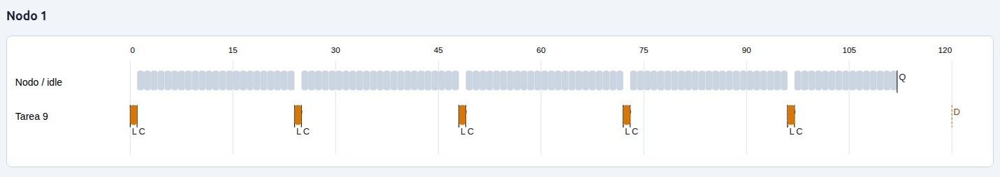

**Nodo 2 (Pico):**

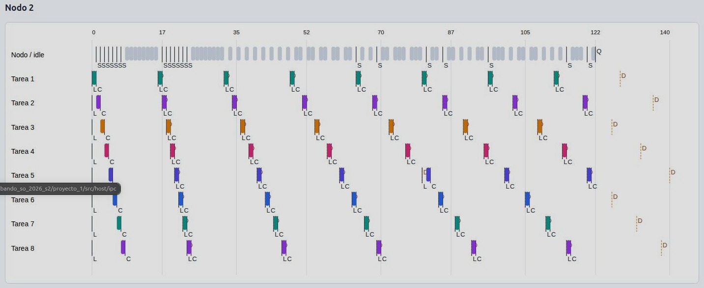

**Utilización:**

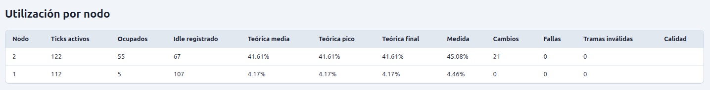

| Nodo | Ticks activos | Ocupados | Idle registrado | Teórica | Medida | Cambios |
| --- | ---: | ---: | ---: | ---: | ---: | ---: |
| 1 | 112 | 5 | 107 | 4.17 % | 4.46 % | 0 |
| 2 | 122 | 55 | 67 | 41.61 % | 45.08 % | 21 |

La diferencia de utilización teórica entre los nodos es de **37.44 puntos porcentuales**, reflejando una asignación poco equilibrada.

### 3.4. Worst-Fit con EDF

En este caso el nodo 1 recibe las tareas 2, 3, 5, 8 y 9; el nodo 2 ejecuta las tareas 1, 4, 6 y 7. Ambas gráficas muestran actividad periódica distribuida.

**Nodo 1 (ESP):**

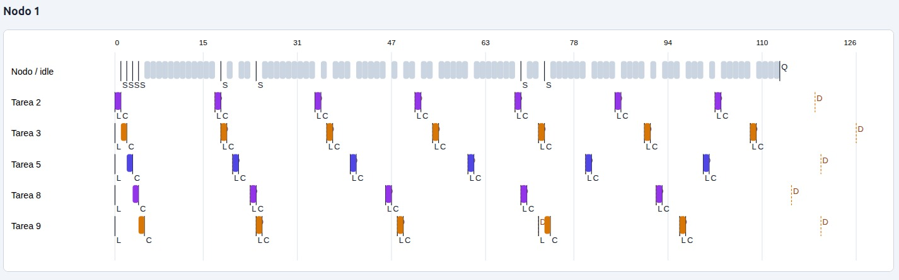

**Nodo 2 (Pico):**

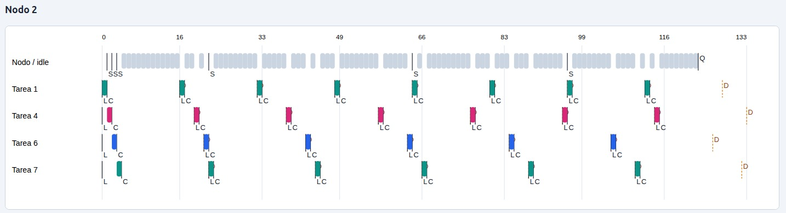

**Utilización:**

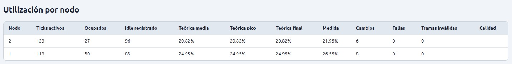

| Nodo | Ticks activos | Ocupados | Idle registrado | Teórica | Medida | Cambios |
| --- | ---: | ---: | ---: | ---: | ---: | ---: |
| 1 | 113 | 30 | 83 | 24.95 % | 26.55 % | 8 |
| 2 | 123 | 27 | 96 | 20.82 % | 21.95 % | 6 |

La diferencia de utilización teórica se reduce a **4.13 puntos porcentuales**, resultado considerablemente más equilibrado que First-Fit.

### 3.5. First-Fit con RMS

El reparto de tareas vuelve a concentrarse en el nodo 2: solo la tarea 9 aparece en el nodo 1, mientras que las tareas 1 a 8 se encuentran en el nodo 2.

**Nodo 1 (ESP):**

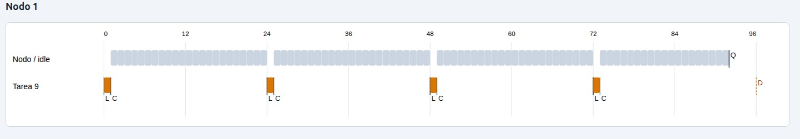

**Nodo 2 (Pico):**

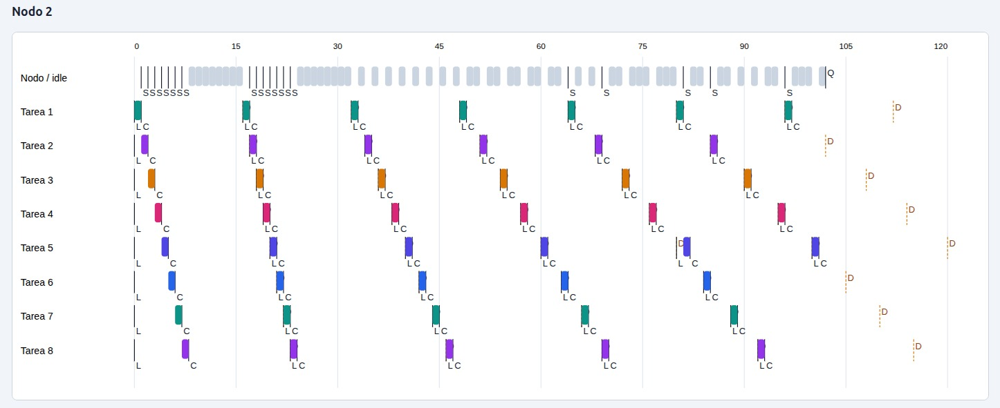

**Utilización:**

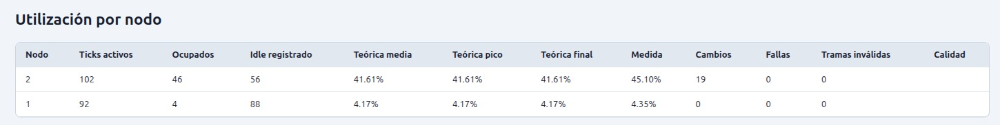

| Nodo | Ticks activos | Ocupados | Idle registrado | Teórica | Medida | Cambios |
| --- | ---: | ---: | ---: | ---: | ---: | ---: |
| 1 | 92 | 4 | 88 | 4.17 % | 4.35 % | 0 |
| 2 | 102 | 46 | 56 | 41.61 % | 45.10 % | 19 |

La diferencia teórica de **37.44 puntos porcentuales** coincide con la observada con EDF, porque el reparto de carga por nodo es el mismo.

### 3.6. Worst-Fit con RMS

La asignación se divide nuevamente entre ambos nodos: tareas 2, 3, 5, 8 y 9 en el primero, y tareas 1, 4, 6 y 7 en el segundo.

**Nodo 1 (ESP):**

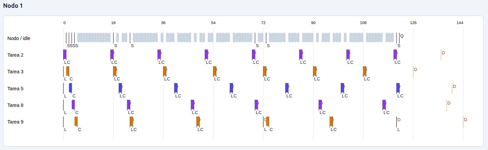

**Nodo 2 (Pico):**

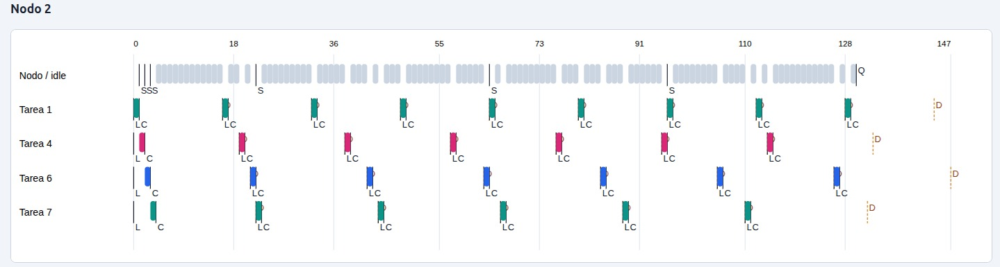

**Utilización:**

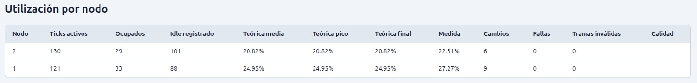

| Nodo | Ticks activos | Ocupados | Idle registrado | Teórica | Medida | Cambios |
| --- | ---: | ---: | ---: | ---: | ---: | ---: |
| 1 | 121 | 33 | 88 | 24.95 % | 27.27 % | 9 |
| 2 | 130 | 29 | 101 | 20.82 % | 22.31 % | 6 |

La diferencia teórica vuelve a ser de **4.13 puntos porcentuales**. Se mantiene, por tanto, el mejor equilibrio de utilización proporcionado por Worst-Fit para esta carga.

### 3.7. Comparación general de First-Fit y Worst-Fit

| Planificador | Heurística | Utilización teórica nodo 1 | Utilización teórica nodo 2 | Diferencia entre nodos | Utilización medida nodo 1 | Utilización medida nodo 2 |
| --- | --- | ---: | ---: | ---: | ---: | ---: |
| EDF | First-Fit | 4.17 % | 41.61 % | **37.44 pp** | 4.46 % | 45.08 % |
| EDF | Worst-Fit | 24.95 % | 20.82 % | **4.13 pp** | 26.55 % | 21.95 % |
| RMS | First-Fit | 4.17 % | 41.61 % | **37.44 pp** | 4.35 % | 45.10 % |
| RMS | Worst-Fit | 24.95 % | 20.82 % | **4.13 pp** | 27.27 % | 22.31 % |

*pp = puntos porcentuales.*

La suma de utilización teórica es prácticamente constante entre heurísticas (**45.78 % con First-Fit y 45.77 % con Worst-Fit**, diferencia debida al redondeo mostrado en las tablas). Por tanto, **no se reduce la carga total: se redistribuye**. Worst-Fit disminuye el desequilibrio de **37.44 pp a 4.13 pp** tanto con EDF como con RMS.

Las pequeñas diferencias entre utilizaciones medidas y teóricas pueden relacionarse con las distintas duraciones de captura, la fase de las tareas y los ticks de actividad efectivamente registrados. Por esa razón no se deben interpretar estas muestras como mediciones de idéntica duración.

En las cuatro tablas de este segundo experimento, los campos «Fallas» y «Tramas inválidas» muestran **0** para ambos nodos; este dato describe los contadores reportados, sin sustituir una verificación específica de cumplimiento de *deadlines*.

> **Conclusión del experimento 2:** se cumple el objetivo de producir **asignaciones diferentes** con First-Fit y Worst-Fit. Para la carga ensayada, Worst-Fit presenta una distribución de utilización notablemente más equilibrada en los dos nodos, y el resultado se repite bajo EDF y RMS.

---

## 4. Conclusiones generales

1. **RMS y EDF:** las capturas presentan cronogramas y utilizaciones diferentes, y la ejecución RMS muestra indicios de retrasos respecto de los plazos. No obstante, falta una medición explícita de incumplimientos y una comparación que conserve fija la asignación de tareas para demostrar rigurosamente que **solo EDF cumple** la carga ensayada.
2. **First-Fit y Worst-Fit:** la diferencia de asignaciones queda comprobada en las gráficas. First-Fit concentra ocho tareas en el nodo 2, mientras que Worst-Fit reparte las nueve tareas entre ambos nodos.
3. **Equilibrio de utilización:** Worst-Fit reduce la diferencia de carga teórica entre nodos de 37.44 a 4.13 puntos porcentuales, sin cambiar de forma relevante la utilización teórica total.
4. **Consistencia de las evidencias:** los valores numéricos de este informe se transcriben de las tablas originales; la interpretación de incumplimientos temporales se mantiene separada de los campos de fallas y tramas inválidas, cuyo significado exacto debe validarse con la implementación.
